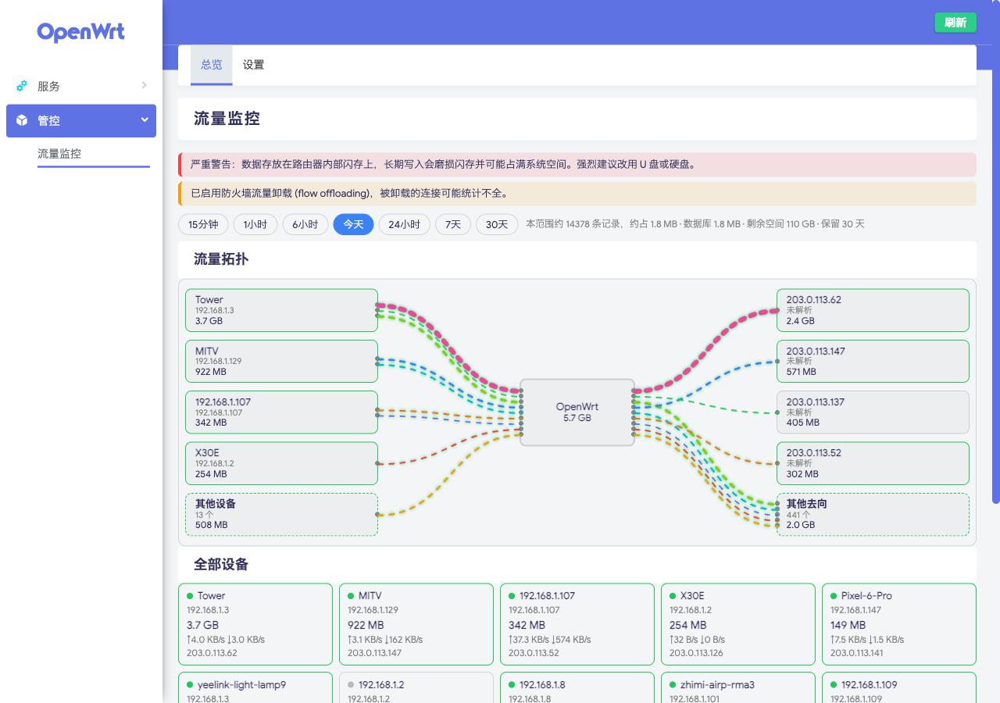
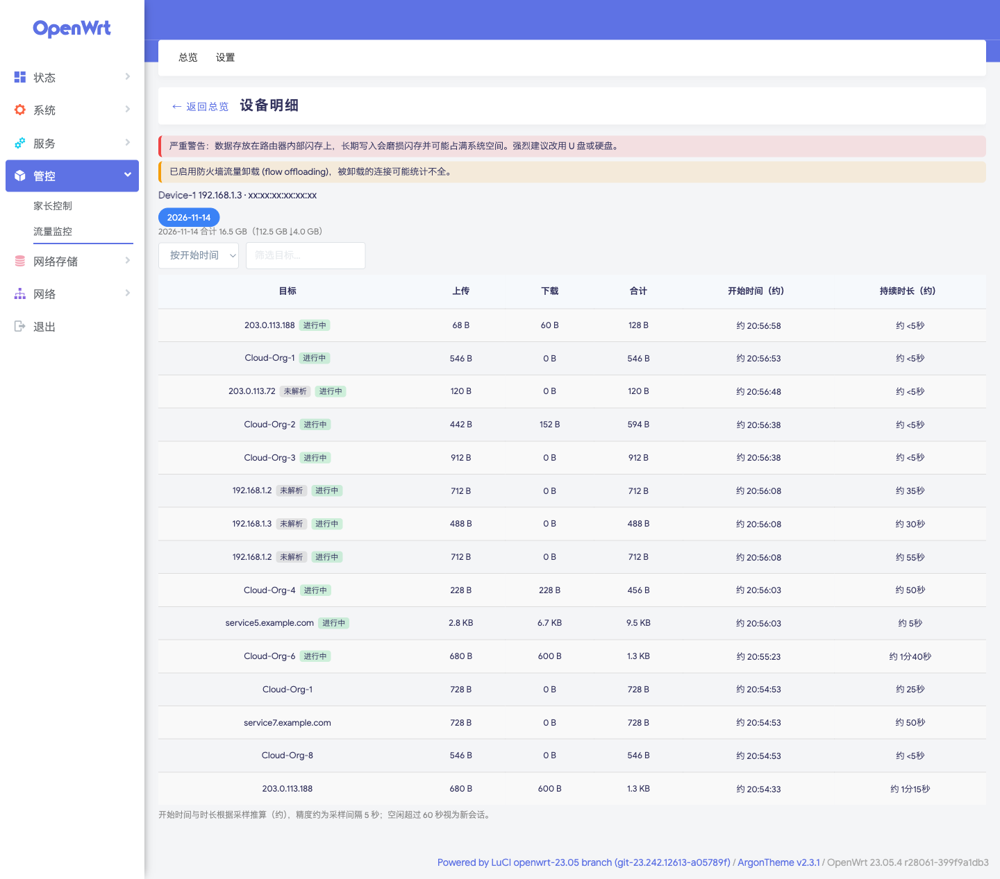

# luci-app-netmonitor

OpenWrt / ImmortalWrt / iStoreOS LuCI 插件：按局域网设备统计「谁访问了哪里、用了多少流量」。

- **左→中→右流量拓扑**：设备 → 网关 → 目标（Top4 +「其他」），同色路径、流动动画；边上可看 ↑上传 / ↓下载
- **设备网格**：全量设备卡片，时段 ↑↓ 与实时速率
- **按天会话明细**：目标 / 上传下载 / 约略开始时间与时长
- **目标命名**：DNS 优先；对仍「未解析」的 IP，可选探测 TLS SNI / HTTP Host（需 `tcpdump`）
- **可配置保留**：按自然时间清理；存储目录可指向 U 盘 / 硬盘，闪存写入有容量预警

> 请尽量让设备使用路由器 DNS，并关闭 DoH/DoT。SNI 探测覆盖部分硬编码 IP 的智能硬件；QUIC / 已 offload 连接仍可能看不到名字。设备内进程级归因尚未支持。

菜单路径：**管控 → 流量监控**

## 截图

截图已脱敏：局域网 IP 改为 `192.168.1.x`，外网目标改为文档保留段 `203.0.113.x`，MAC 遮盖，设备名去掉尾部硬件 ID（保留如 `X30E`、`yeelink-light-lamp9` 等可读前缀）。

### 总览（拓扑 + 设备网格）



### 设备明细（按天会话）



### 设置（存储 / 保留 / 采样）


## 安装

Release 提供 **architecture = all** 的通用包，不区分芯片（x86_64 / aarch64 / mips 等均可，只要系统是支持的 OpenWrt 系且具备依赖）。

### 依赖

- `lua`、`sqlite3-cli`、`ip-tiny`（或提供 `ip` 的等价包）
- LuCI（`luci-base`）

### 方式 A：opkg（传统 `.ipk`）

从 [Releases](https://github.com/neohob/luci-app-netmonitor/releases) 下载两个包后：

```sh
opkg update
opkg install ./netmonitor_0.2.0-1_all.ipk
opkg install ./luci-app-netmonitor_0.2.0-1_all.ipk
# 可选（SNI/Host 探测）：
opkg install tcpdump
```

### 方式 B：iStore / 自解压 `.run`

适合 iStoreOS 或习惯一键脚本的场景（内含采集器 + LuCI，与 CPU 架构无关）：

```sh
chmod +x luci-app-netmonitor_0.2.0-1_all.run
sh luci-app-netmonitor_0.2.0-1_all.run          # 安装 / 升级
# sh luci-app-netmonitor_0.2.0-1_all.run uninstall  # 卸载（保留配置与数据库）
```

装完刷新 LuCI，进入 **管控 → 流量监控**。建议在设置里把存储目录改到外置磁盘，避免长期写闪存。

## 本地组包

```sh
./scripts/build_release.sh          # 输出到 dist/
# 生成：
#   netmonitor_<ver>_all.ipk
#   luci-app-netmonitor_<ver>_all.ipk
#   luci-app-netmonitor_<ver>_all.run
#   SHA256SUMS
```

可选：SSH 热更新（需自行设置环境变量，仓库内不包含密钥/主机）：

```sh
export GOOP_KEY=~/.ssh/id_ed25519
export GOOP_HOST=root@192.168.1.1
./scripts/deploy-goop.sh
```

## 包结构

| 包名 | 说明 |
|------|------|
| `netmonitor` | 采集器 + SQLite + `ubus`/`rpcd` API |
| `luci-app-netmonitor` | LuCI 视图（总览 / 设置 / 设备明细） |

## 说明与限制

- 基于 `nf_conntrack` 字节计数采样（默认 5s），会话起止为约略值
- 开启防火墙 **flow offloading** 时，被卸载连接可能统计不全（界面会提示）
- 不做 SNI/DPI；目标名仅来自本机 DNS 缓存关联

## License

Apache-2.0
