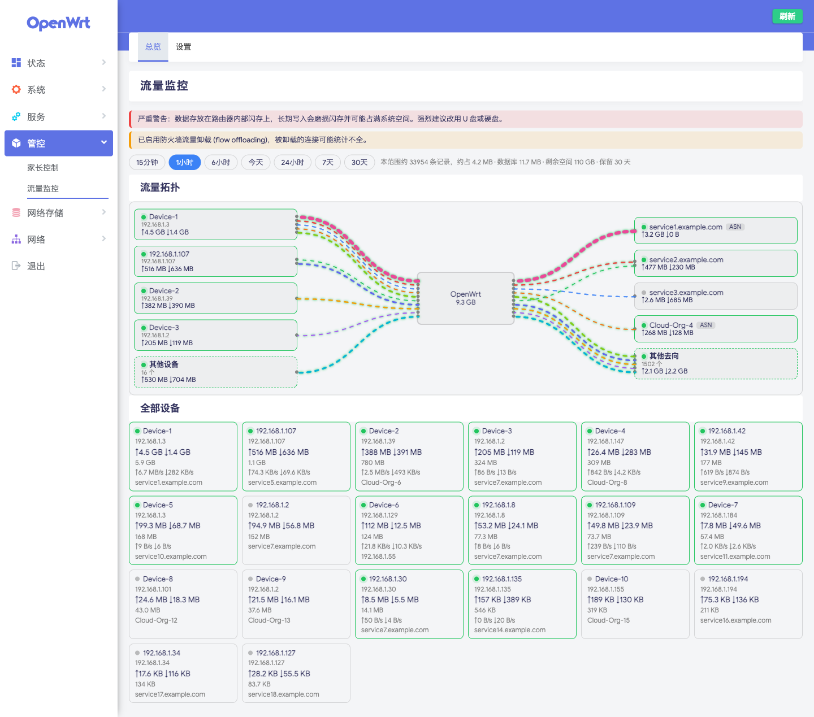
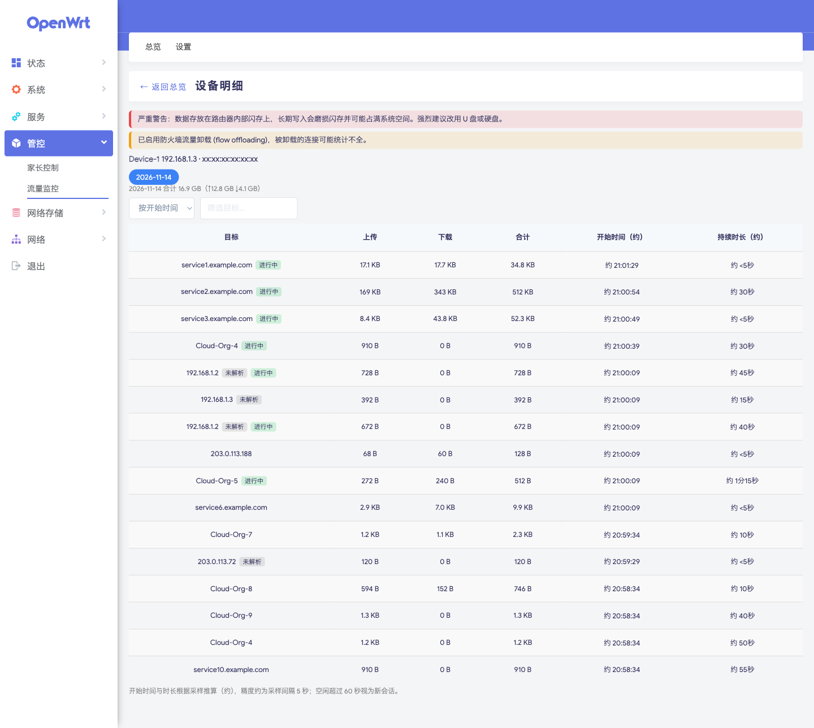
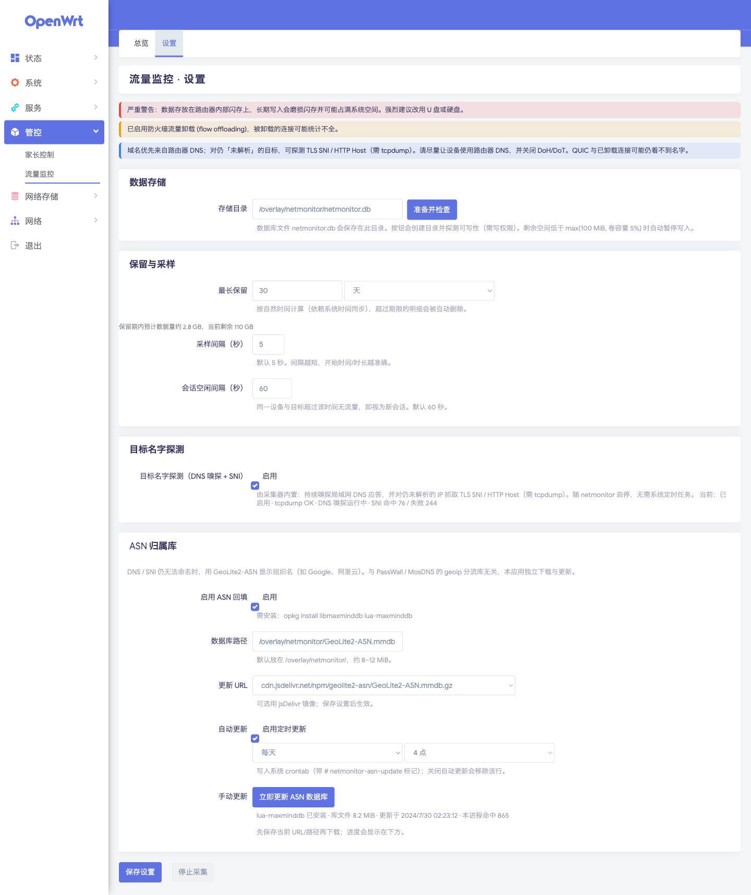

# luci-app-netmonitor

OpenWrt / ImmortalWrt / iStoreOS LuCI 插件：按局域网设备统计「谁访问了哪里、用了多少流量」。

- **左→中→右流量拓扑**：设备 → 网关 → 目标（Top4 +「其他」），同色路径、流动动画；边上可看 ↑上传 / ↓下载
- **设备网格**：全量设备卡片，时段 ↑↓ 与实时速率
- **按天会话明细**：同名目标合并可展开、表头排序、日历选日（有数据日高亮）；选哪天只看哪天
- **明细仅当月**：详细采样与会话只保留当前日历月；跨月后自动汇总为每设备 Top100 +「其他」
- **往月汇总**：设备明细页可查看过去月份的目的地合计（无分时会话展开）
- **繁忙设备分页**：按**目的地**完整合计后分页（每页约 80 个目的地，每个都是当天全量）；可「加载更多」；展开可看分时会话
- **自然日结清**：本地 0 点软切换统计会话（不断开真实 TCP）；空闲超过 `idle_gap` 再起流量则重新计数
- **目标命名**：DNS → SNI/Host → **云/CDN 服务网段**（字节跳动、Cloudflare、AWS…）→ IP + ASN 标签 → 纯 IP
- **服务网段库**：设置页可启用与定时/手动更新（metowolf + disposable，约 340 KiB）
- **ASN 归属库**：作标签补充（主名不再用 Chinanet 这类宽泛组织名）；与 PassWall / MosDNS 分流 geoip 无关
- **存储路径**：可指向 U 盘 / 硬盘，闪存写入有容量预警

> 请尽量让设备使用路由器 DNS，并关闭 DoH/DoT。SNI / 服务网段 / ASN 可覆盖部分硬编码 IP；家宽 P2P 对端无法标成 App 名。QUIC / 已 offload 连接仍可能看不到名字。设备内进程级归因尚未支持。

菜单路径：**管控 → 流量监控**

**当前版本 0.6.2** — 变更说明见 [GitHub Releases](https://github.com/neohob/luci-app-netmonitor/releases)（当月明细 + 往月 Top100 汇总；目的地完整合计分页；OFFLOAD 假流量修复）。

## 截图

### 总览（拓扑 + 设备网格）



### 设备明细（按天会话）



### 设置（存储 / 探测 / 服务网段 / ASN）



## 安装

Release 提供 **architecture = all** 的通用包，不区分芯片（x86_64 / aarch64 / mips 等均可，只要系统是支持的 OpenWrt 系且具备依赖）。

### 依赖

- `lua`、`sqlite3-cli`、`ip-tiny`（或提供 `ip` 的等价包）
- LuCI（`luci-base`）
- 可选：`tcpdump`（SNI / HTTP Host 探测）
- 可选：`libmaxminddb`、`lua-maxminddb`（ASN 组织名回填）

### 方式 A：opkg（传统 `.ipk`）

从 [Releases](https://github.com/neohob/luci-app-netmonitor/releases) 下载两个包后：

```sh
opkg update
opkg install ./netmonitor_0.6.2-1_all.ipk
opkg install ./luci-app-netmonitor_0.6.2-1_all.ipk
# 可选：
opkg install tcpdump
opkg install libmaxminddb lua-maxminddb
```

### 方式 B：iStore / 自解压 `.run`

适合 iStoreOS 或习惯一键脚本的场景（内含采集器 + LuCI，与 CPU 架构无关）：

```sh
chmod +x luci-app-netmonitor_0.6.2-1_all.run
sh luci-app-netmonitor_0.6.2-1_all.run          # 安装 / 升级
# sh luci-app-netmonitor_0.6.2-1_all.run uninstall  # 卸载（保留配置与数据库）
```

装完刷新 LuCI，进入 **管控 → 流量监控**。建议在设置里把存储目录改到外置磁盘，避免长期写闪存。设置中可「立即更新服务网段」与「立即更新 ASN 数据库」。

## 本地组包

```sh
./scripts/build_release.sh          # 输出到 dist/
# 生成：
#   netmonitor_<ver>_all.ipk
#   luci-app-netmonitor_<ver>_all.ipk
#   luci-app-netmonitor_<ver>_all.run
#   SHA256SUMS
```

可选：SSH 热更新（需自行设置环境变量，仓库内不包含密钥/主机）：

```sh
export GOOP_KEY=~/.ssh/id_ed25519
export GOOP_HOST=root@192.168.1.1
./scripts/deploy-goop.sh
```

## 包结构

| 包名 | 说明 |
|------|------|
| `netmonitor` | 采集器 + SQLite + `ubus`/`rpcd` API（含 DNS 嗅探 / 服务网段 / ASN 更新脚本） |
| `luci-app-netmonitor` | LuCI 视图（总览 / 设置 / 设备明细） |

## 说明与限制

- 基于 `nf_conntrack` 字节计数采样（默认 5s），会话起止为约略值；监控「会话」≠ 单条 TCP 长连接（`idle_gap` 内有字节即续上）
- 本地日历 **0 点**会结清统计会话并重新计数，**不断开**真实连接；日明细按所选自然日汇总
- 开启防火墙 **flow offloading** 时，被卸载连接可能统计不全（界面会提示）；0.5.2 起避免 OFFLOAD 长连接被整段重算成假大流量
- 0.5.3/0.5.4：繁忙设备按**目的地**做当天完整合计再分页（不会把同一目的地的会话拆进名额里只统计一部分）；展开加载该目的地分时会话；「加载更多」续拉更多目的地
- 目标名优先级：DNS → SNI / HTTP Host → 云/CDN 服务网段 → IP（+ ASN 标签）→ 原始 IP
- 服务网段来自 [metowolf/iplist](https://github.com/metowolf/iplist) 与 [disposable/cloud-ip-ranges](https://github.com/disposable/cloud-ip-ranges)
- ASN 使用独立的 GeoLite2-ASN（或兼容 MMDB），不读取 PassWall / MosDNS 的 `geoip.dat`
- This product includes GeoLite2 data created by MaxMind, available from [maxmind.com](https://www.maxmind.com)

## License

Apache-2.0
